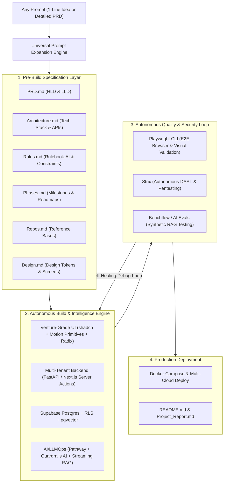

# 🛸 Antigravity Master SaaS Blueprint & Autonomous Lifecycle Protocol
> **Standard Operating Procedure (SOP) & Production Architecture Framework**
> **File Identification:** `antigravity.md` / `AGENTS.md` / `GEMINI.md` / `.agents/rules/antigravity.md`

---

## 📑 Table of Contents
1. [Executive Summary: From Vibe-Coding to Vibe-Engineering](#1-executive-summary-from-vibe-coding-to-vibe-engineering)
2. [Resource & Knowledge Base Deep Technical Evaluation](#2-resource--knowledge-base-deep-technical-evaluation)
3. [The Universal Prompt Expansion Engine (1-Line $\to$ Production SaaS)](#3-the-universal-prompt-expansion-engine-1-line-to-production-saas)
4. [Pre-Build Specification Layer (Phase 0: Planning)](#4-pre-build-specification-layer-phase-0-planning)
5. [In-Flight Runtime Observability & Self-Healing Layer](#5-in-flight-runtime-observability--self-healing-layer)
6. [Holy Grail Consolidation & Master Reporting Layer](#6-holy-grail-consolidation--master-reporting-layer)
7. [The 5 Mandatory Safety Guardrails](#7-the-5-mandatory-safety-guardrails)
8. [Concrete Case Study: B2B Predictive AI Churn SaaS](#8-concrete-case-study-b2b-predictive-ai-churn-saas)
9. [Setup & Activation Instructions](#9-setup--activation-instructions)

---

## 1. Executive Summary: From Vibe-Coding to Vibe-Engineering

Can we build, vibe-code, and autonomously ship **production-level, industrial-grade, end-to-end SaaS applications** using these curated repositories, design platforms, AI plugins, and architectures?

### **The Verdict: YES.**
When casual "vibe coding" (blindly prompting an LLM without constraints) is upgraded into **"Vibe Engineering"** (combining deterministic planning, state-machine agent loops, type-safe headless primitives, automated DAST red-teaming, and headless browser validation), an AI agent can build scalable, multi-tenant, venture-grade SaaS applications from start to finish.



---

## 2. Resource & Knowledge Base Deep Technical Evaluation

Every link and tool in the ecosystem has been rigorously evaluated for its concrete production utility:

### A. Specialized Plugins & Developer Tooling
| Tool / Plugin | Concrete Utility & Production Value | Autonomous Agent Role |
| :--- | :--- | :--- |
| **Playwright CLI** | Multi-browser headless automation, DOM snapshotting, network interception, visual regression testing. | **Sensory & Verification Cortex:** Simulates user signup, payments, and dashboard flows; self-heals failing code upon assertion error. |
| **Supabase CLI** | Local containerized Postgres, GoTrue Auth, Realtime WebSockets, Storage, and pgvector. | **Data Infrastructure Engine:** Executes schema migrations, generates declarative Row-Level Security (RLS) policies, seeds data. |
| **Strix Pentesting** | Model-agnostic autonomous security agent for DAST, AST vulnerability detection, and exploit validation. | **Adversary Simulator:** Automated red-teaming directly in CI/CD; probes for BOLA/IDOR, tenant data leakage, and auth bypasses. |
| **Skill UI** | Modular UI components tailored for agentic telemetry, skill invocation trees, and execution traces. | **Agent Telemetry Interface:** Renders human-in-the-loop (HITL) approval workflows and conversational canvases effortlessly. |
| **Context7** | Real-time MCP documentation server that injects version-specific library docs into AI context. | **Hallucination Prevention:** Feeds latest API specs and breaking changes directly to the model, eliminating outdated code generation. |

---

### B. Vibe-Coding Governance & Scaffolding
- **`rulebook-ai`**: Declarative governance engine that transforms loose user intent into strict architectural rules (strict TypeScript, Zod schemas, RLS enforcement, atomic component design).
- **`vibekit`**: Production-grade scaffolding toolkit and sandboxing layer for generating clean boilerplates (Next.js 15, FastAPI, Tailwind) without hallucinated overhead.
- **`awesome-vibe-coding`**: Knowledge catalog of multi-file editing strategies, cursor rules, and chaining patterns for autonomous agents.

---

### C. System Design, Scalability & Backend Architecture
- **`donnemartin/system-design-primer` & `ashishps1/awesome-system-design-resources`**: Canonical blueprints for horizontal scaling, database sharding, Cache-Aside patterns (Redis), message queues (Kafka, Celery/BullMQ), and load balancing.
- **`chiphuyen/machine-learning-systems-design`**: Gold standard for production ML pipelines: offline batch feature engineering vs. online real-time inference, embedding caching, model drift monitoring.
- **`awesome-scalability` & `backend-cheats` / `awesome-backend`**: Production backend invariants: database indexing on foreign keys (`tenant_id`), connection pooling with PgBouncer, structured JSON logging, idempotent API design (`Idempotency-Key`).
- **`awesome-compose` & `free-for-dev`**: 1-command multi-container Docker templates and a curated directory of zero-cost production cloud tiers (Fly.io, Cloudflare, Neon, Qdrant, Upstash).

---

### D. Modern Frontend UI/UX, Motion & Design Systems
- **`shadcn/ui`, `Radix UI` & `@base-ui/react`**: Accessible, unstyled, headless UI primitives combined with Tailwind CSS. Zero runtime CSS overhead, 100% WAI-ARIA compliance.
- **`React Hook Form` (+ Zod)**: Uncontrolled, high-performance form state management with end-to-end type validation.
- **`Inspira UI`, `Lenis`, `Animate UI` & `Motion Primitives`**: Physics-based micro-interactions, smooth scrolling, layout transitions, and modern dashboard visual polish (glowing borders, animated counters, interactive charts).
- **Design Reference Galleries (`Recent.design`, `Refero.design`, `Awwwards`, `Mobbin`)**: Real-world SaaS UX heuristics for onboarding wizards, billing upgrade flows, command palettes (`Cmd+K`), and data filter matrices.

---

### E. Machine Learning, Deep Learning, Applied AI & LLMOps
- **`500 AI Projects` & `RAG Techniques (NirDiamant)`**: Implementations for tabular ML, computer vision, hybrid search (dense + sparse BM25), GraphRAG, and cross-encoder re-ranking.
- **`Pathway LLMOps`**: High-throughput streaming RAG and event-driven data processing in Rust/Python for live data sync without batch re-indexing.
- **`Guardrails AI` & `Prompt Engineering Guide`**: Output structural validation (JSON schema enforcement, PII redaction, anti-jailbreak filters).
- **`Awesome AI Eval` & `Benchflow`**: Automated synthetic evaluation harnesses to measure RAG faithfulness, context precision, and model accuracy before promotion.
- **`AI Agents Repositories` (LangGraph, CrewAI, AutoGen, Smolagents)**: State-machine-based multi-agent orchestration with persistent memory and tool execution loops.

---

## 3. The Universal Prompt Expansion Engine (1-Line $\to$ Production SaaS)

Regardless of whether the user inputs a **1-line prompt** (e.g., *"Build an AI churn prediction SaaS"*) or a **detailed 50-page enterprise specification**, Antigravity runs the **8-Stage Deterministic Meta-Compilation Pipeline**:

```
[User Prompt: 1-Line or Detailed]
   │
   ▼
[Stage 1: Intent & Feature Decomposition]
   ├── Core Value Proposition & Target Personas
   ├── Implicit Baseline SaaS Requirements: Auth (RBAC), Multi-Tenancy, Stripe Billing, Audit Logs, Analytics
   └── Core Domain Feature Breakdown
   │
   ▼
[Stage 2: Architectural Specification & Stack Matrix Selection]
   ├── Frontend: Next.js 15 (App Router, Server Actions) + Tailwind + shadcn/ui + Motion Primitives + Lenis
   ├── Backend: Python FastAPI (ML/LLM service) + Next.js Route Handlers (CRUD/Auth)
   ├── Database: Supabase PostgreSQL + pgvector + Row-Level Security (RLS)
   ├── Queue & Cache: Redis + Celery / BullMQ
   └── AI / LLMOps: Pathway / LangGraph + Guardrails AI + Synthetic Evals
   │
   ▼
[Stage 3: Declarative Multi-Tenant Schema Generation]
   ├── PostgreSQL Schema with composite indices (tenant_id, created_at)
   ├── Foreign key cascade rules & soft delete columns
   └── Row-Level Security (RLS) policies enforcing 100% data isolation
   │
   ▼
[Stage 4: ML / LLM Inference Pipeline Synthesis]
   ├── Tabular / Deep Feature Engineering (Scikit-Learn / XGBoost / PyTorch)
   ├── Semantic Embedding & Hybrid Search (pgvector + BM25)
   └── Guardrails AI validation layer for zero-hallucination JSON responses
   │
   ▼
[Stage 5: High-Performance API & Webhook Layer]
   ├── Zod & Pydantic request/response validation schemas
   ├── Stripe Webhook signature verification and subscription lifecycle management
   └── Idempotent transaction headers and rate limiting
   │
   ▼
[Stage 6: Venture-Grade UI/UX Assembly]
   ├── Responsive dashboard based on Mobbin/Refero SaaS design patterns
   ├── Data tables with sorting, multi-column filtering, pagination, and CSV export
   └── Micro-interactions, smooth counters, and command palettes
   │
   ▼
[Stage 7: Autonomous Security Audit (Strix Integration)]
   ├── Automated DAST penetration testing & BOLA/IDOR vulnerability checks
   └── Tenant isolation cross-probe (Tenant A attempts reading Tenant B data)
   │
   ▼
[Stage 8: Deterministic End-to-End Verification (Playwright CLI)]
   ├── Automated headless browser test execution (Signup $\to$ Ingest $\to$ Insight $\to$ Stripe Checkout)
   └── Self-healing loop: On assertion failure, auto-patch code and re-verify
```

---

## 4. Pre-Build Specification Layer (Phase 0: Planning)

Before generating code, produce the 6 core specification files:
1. **`PRD.md`**: Problem statement, target personas, functional requirements, non-functional SLAs, HLD & LLD system designs.
2. **`Architecture.md`**: Tech stack matrix, microservices, API contracts, folder hierarchy, ERD schemas, caching strategies.
3. **`Rules.md`**: Library whitelist/blacklist, coding standards, error handling paradigms, anti-patterns.
4. **`Phases.md`**: Granular phased roadmap with concrete milestones and acceptance criteria per phase.
5. **`Repos.md`**: Curated reference repositories, official library documentation links, SDK schemas.
6. **`Design.md`**: Design tokens (palette, typography, spacing), dark/light mode specs, component wireframes, micro-animation specs.

---

## 5. In-Flight Runtime Observability & Self-Healing Layer

During code execution, maintain the following living documents simultaneously:
- **`Memory.md`**: Active state, completed modules, current blockers, environment keys (prevents context loss and token waste).
- **`Decisions.md` / `Logs.md`**: Architectural Decision Records (ADRs) capturing *Why*, *When*, *By Whom*, and *Where*.
- **`Flow.md`**: Execution paths, request-response lifecycles, and data mutation trails across components.
- **`Bugs.md` / `Features.md`**: Issue tracker with Root Cause Analysis (RCA), file/line markers, and test verification scripts.

---

## 6. Holy Grail Consolidation & Master Reporting Layer

Upon completion, synthesize the codebase into two comprehensive artifacts:
- **`README.md`**: Public-facing documentation with architecture diagrams, UI screenshots, setup instructions, and latency benchmarks.
- **`Project_Report.md` / `.docx`**: Complete chapter-wise dossier (Chapters 1–8 + Appendices) with a structured index for executive review.

---

## 7. The 5 Mandatory Safety Guardrails

```
┌─────────────────────────────────────────────────────────────────────────────┐
│                       CORE AGENT SAFETY DIRECTIVES                          │
├─────────────────────────────────────────────────────────────────────────────┤
│ 1. PLANNING BEFORE CODING:                                                  │
│    Inspect all relevant files and produce an Implementation Plan. Define    │
│    target files, exact changes, and risk mitigations. Await confirmation.   │
│                                                                             │
│ 2. STRICT SCOPE LIMITATION:                                                 │
│    Modify ONLY files strictly required for the assigned task. Never         │
│    refactor, rename, or reorganize unrelated modules unsolicited.           │
│                                                                             │
│ 3. INCREMENTAL VERIFIED WORK:                                               │
│    Execute changes in small, testable increments. Explain changes and       │
│    verify functionality before advancing to subsequent milestones.          │
│                                                                             │
│ 4. PATTERN & IDIOM ADHERENCE:                                               │
│    Mirror existing architectural idioms, naming conventions, and syntax.    │
│    Never introduce unnecessary dependencies or alien abstractions.          │
│                                                                             │
│ 5. RIGOROUS AUDIT & VERIFICATION:                                           │
│    Summarize every touched file, detail side-effect risks, and output a     │
│    bulletproof manual testing checklist prior to deployment.                │
└─────────────────────────────────────────────────────────────────────────────┘
```

---

## 8. Concrete Case Study: B2B Predictive AI Churn SaaS

### Multi-Tenant Database Schema with Row-Level Security (`001_churn_saas.sql`)
```sql
create extension if not exists "uuid-ossp";
create extension if not exists "vector";

create table public.organizations (
    id uuid primary key default uuid_generate_v4(),
    name text not null,
    slug text unique not null,
    stripe_customer_id text,
    subscription_status text default 'trialing',
    created_at timestamptz default now() not null
);

create table public.users (
    id uuid primary key references auth.users(id) on delete cascade,
    organization_id uuid references public.organizations(id) on delete cascade not null,
    email text not null,
    role text default 'member' check (role in ('owner', 'admin', 'member')),
    created_at timestamptz default now() not null
);

create table public.customers (
    id uuid primary key default uuid_generate_v4(),
    organization_id uuid references public.organizations(id) on delete cascade not null,
    external_id text not null,
    name text not null,
    mrr numeric(10, 2) default 0.00 not null,
    churn_probability float default 0.0 check (churn_probability between 0.0 and 1.0),
    risk_level text generated always as (
        case 
            when churn_probability >= 0.75 then 'CRITICAL'
            when churn_probability >= 0.40 then 'MEDIUM'
            else 'LOW'
        end
    ) stored,
    churn_reasons jsonb default '[]'::jsonb,
    embedding vector(1536),
    created_at timestamptz default now() not null,
    unique(organization_id, external_id)
);

create index idx_customers_org_risk on public.customers (organization_id, churn_probability desc);

alter table public.organizations enable row level security;
alter table public.users enable row level security;
alter table public.customers enable row level security;

create policy "Tenant Isolation for Customers"
    on public.customers for all
    using (organization_id in (select organization_id from public.users where id = auth.uid()));
```

---

## 9. Setup & Activation Instructions

- **Machine Global Skill (Active)**: Located at `C:\Users\ranan\.gemini\config\skills\antigravity-project-blueprint\SKILL.md`.
- **Project Root Rule**: Copy to `.agents/rules/antigravity.md` or `AGENTS.md` in any project repository to enforce these protocols automatically.
