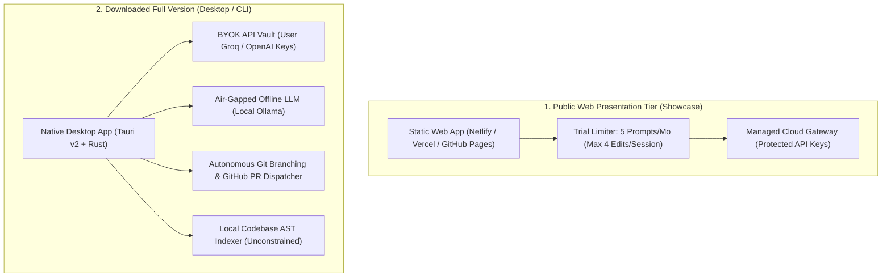

# Vo-Gen-Flow: Complete Deployment & Operations Manual (DEPLOYMENT.md)
> **Production Deployment, Dual-Target Architecture & Operational Playbook**  
> **Author:** maihun-rsc <rananjaychauhan93@gmail.com>  
> **Version:** 2.0.0 Production  

---

## 1. Architectural Model: Web Showcase vs. Downloaded Desktop Application

Vo-Gen-Flow implements a **two-tier deployment topology** to balance public product presentation with enterprise workload offloading:



### Key Differences Between Versions

| Capability | Public Web Version (Showcase) | Downloaded Desktop / CLI Version |
| :--- | :--- | :--- |
| **Primary Purpose** | Interactive product overview, demo, and evaluation. | Full production software architecture synthesis and code generation. |
| **API Key Entry (BYOK)** | **Disabled** (Managed free tier, zero key entry). | **Enabled** (User brings their own key or uses local Ollama). |
| **Usage Limits** | 5 prompts / month (Max 4 iterative edits per session). | **Unlimited** (Bound only by user's personal Groq quota). |
| **Codebase RAG** | In-memory demo snippets & text paste only. | Full recursive filesystem indexing (`.py`, `.ts`, `.sql`, etc.). |
| **Git & PR Dispatcher** | Read-only Master Bundle export & download. | Automated Git branching and live GitHub PR creation (`gh pr create`). |
| **Offline Privacy** | Requires cloud connectivity. | 100% air-gapped via local Ollama (`qwen2.5-coder:latest`). |
| **Server Burden** | Minimal; lightweight static assets + throttled API calls. | **Zero** server load on Vo-Gen-Flow infrastructure. |

---

## 2. Local Development & Testing Launch

To test the application locally and diagnose frontend latency vs. network latency:

### Step 1: Start the Backend API Gateway
```bash
# In repository root: E:\voice-insight-generation
python -m uvicorn src.api.server:app --host 127.0.0.1 --port 8000
```
- Health Check: `http://127.0.0.1:8000/health` (Returns `{"status":"healthy","service":"Vo-Gen-Flow"}`)
- API Documentation: `http://127.0.0.1:8000/docs` (Interactive OpenAPI Swagger UI)
- WebSocket Stream: `ws://127.0.0.1:8000/ws/stream`

### Step 2: Serve the Frontend Web Application
```bash
# In repository root
python -m http.server 3000 --directory "web_app"
```
- Open your browser to: `http://127.0.0.1:3000`

---

## 3. Free Cloud Hosting Deployment

### A. Netlify Deployment (Zero-Cost Static Tier)

The web application requires zero server build steps and deploys directly:

1. **Deploy via Netlify CLI:**
   ```bash
   npx netlify deploy --dir=web_app --prod
   ```
2. **Configuration (`web_app/netlify.toml`):**
   ```toml
   [build]
     publish = "."

   [[headers]]
     for = "/*"
     [headers.values]
       X-Frame-Options = "DENY"
       X-XSS-Protection = "1; mode=block"
       X-Content-Type-Options = "nosniff"
       Referrer-Policy = "strict-origin-when-cross-origin"
   ```
3. **Live Production Instance:** [https://vogenflow-studio.netlify.app](https://vogenflow-studio.netlify.app)

### B. Vercel Deployment
```bash
npx vercel deploy --prod ./web_app
```

---

## 4. Backend Cloud Deployment (Docker & Container Services)

To deploy the FastAPI WebSocket backend to free or low-cost cloud container platforms (Render, Fly.io, Google Cloud Run):

### Multi-Stage Production `Dockerfile`:
```dockerfile
FROM python:3.12-slim AS builder
WORKDIR /app
COPY requirements.txt .
RUN pip install --no-cache-dir -r requirements.txt

FROM python:3.12-slim
WORKDIR /app
COPY --from=builder /usr/local/lib/python3.12/site-packages /usr/local/lib/python3.12/site-packages
COPY --from=builder /usr/local/bin /usr/local/bin
COPY . .
ENV PYTHONUNBUFFERED=1
EXPOSE 8000
CMD ["uvicorn", "src.api.server:app", "--host", "0.0.0.0", "--port", "8000"]
```

---

## 5. Security & Secret Management Protocols

1. **Strict Zero-Hardcoded Secrets Policy**:
   - Never store API keys in HTML input attributes, client JavaScript, or version control.
   - All server API keys (`GROQ_API_KEY`) must reside exclusively in `.env` or cloud container environment secrets.
2. **Web Tier Quota Isolation**:
   - The web app operates under a server-managed rate limiter protecting public endpoints from runaway billing.
3. **Indirect Prompt Injection Defense**:
   - All inputs entering the RAG and deliberation pipelines pass through AST regex pre-filters (`src/rag_engine.py` and `src/model_router.py`) before inference.

---

## 6. Desktop Native Compilation (Tauri v2)

To compile the full-featured desktop binary for Windows, macOS, or Linux:

```bash
# 1. Ensure Rust toolchain is installed
rustc --version

# 2. Build production executable
cargo tauri build
```
- Output binary located at: `src-tauri/target/release/`
