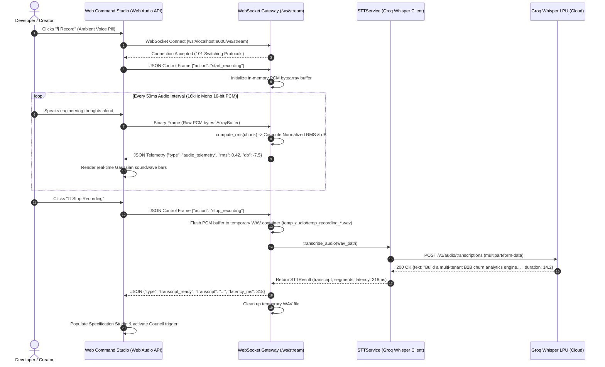
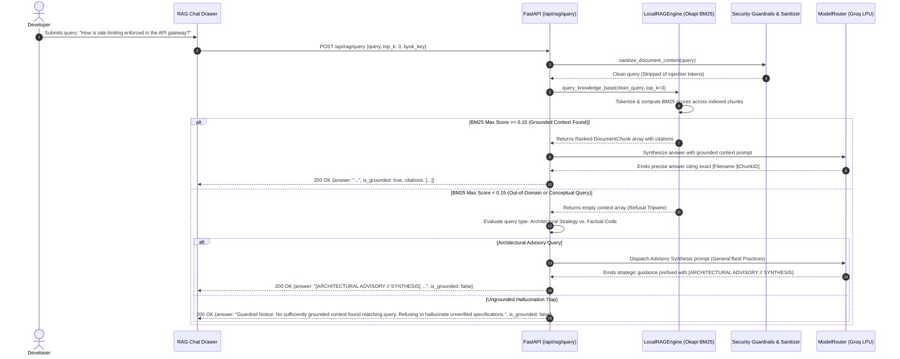
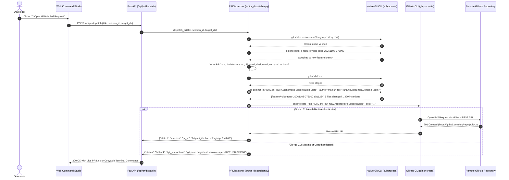

# ⚙️ VoGenFlow 2.0: System Execution Flow & Lifecycle (Flow.md)
> **Document Type:** Production Execution Flow, Sequence Topologies & Lifecycle Manual  
> **Status:** Active & Validated (Anti-Vibe Engineering Standard)  
> **Version:** 2.0.0 Production  
> **Target Audiences:** Lead Architects, Systems Engineers, DevOps Integrators & Autonomous Agents  

---

## 📑 Table of Contents
1. [Unified System Entry Points & Server Lifespans](#1-unified-system-entry-points--server-lifespans)
2. [Real-Time Audio Streaming & Sub-Second Transcription Sequence](#2-real-time-audio-streaming--sub-second-transcription-sequence)
3. [The 3-Stage Scatter-Gather Council Deliberation Sequence](#3-the-3-stage-scatter-gather-council-deliberation-sequence)
4. [Dual-Mode RAG Retrieval & Document Query Resolution Flow](#4-dual-mode-rag-retrieval--document-query-resolution-flow)
5. [Autonomous GitHub PR Dispatch Sequence](#5-autonomous-github-pr-dispatch-sequence)
6. [Comprehensive Function Call Hierarchy & Invocation Matrix](#6-comprehensive-function-call-hierarchy--invocation-matrix)
7. [Error Recovery, Failover Dynamics & Circuit Breaker Transitions](#7-error-recovery-failover-dynamics--circuit-breaker-transitions)
8. [Data Transformation & Multi-Format Artifact Pipeline](#8-data-transformation--multi-format-artifact-pipeline)

---

## 1. Unified System Entry Points & Server Lifespans

VoGenFlow 2.0 operates through three distinct, non-conflicting operational entry points:

```
                                [SYSTEM ENTRY POINTS]
                                          │
         ┌────────────────────────────────┼────────────────────────────────┐
         ▼                                ▼                                ▼
[1. Cloud Web SaaS]             [2. Terminal CLI]              [3. Native Desktop Shell]
uvicorn src.api.server:app      python -m src.cli ...          Tauri v2 (Rust 1.75+)
Port 8000 / Web Studio          Headless Automation            Cross-Platform Desktop
```

### 1.1 Entry Point A: Cloud Web SaaS (`uvicorn src.api.server:app`)
- **Execution Command:** `python -m uvicorn src.api.server:app --host 0.0.0.0 --port 8000 --reload`
- **Lifespan Context Manager (`src/api/server.py:lifespan`):**
  1. **Singleton Initialization:** Instantiates in-memory singletons: `CuratedKnowledgeDB`, `STTService`, and `LocalRAGEngine`.
  2. **Knowledge Pre-Seeding:** Ingests 16 pre-seeded enterprise blueprints from `data/curated_knowledge.json`.
  3. **Local Codebase Pre-Indexing:** Scans the active repository root (excluding `.git`, `node_modules`, and secret files), tokenizing code chunks into the in-memory Okapi BM25 inverted index.
  4. **Static Route Mounting:** Mounts `web_app/` as the static root at `/`, serving the Monolith Luxury Command Studio (`web_app/index.html`).
  5. **Graceful Teardown:** Upon `SIGINT`/`SIGTERM`, cleanly flushes in-memory session caches, unlinks temporary audio files, and terminates active thread pools.

### 1.2 Entry Point B: Terminal Automation CLI (`src/cli.py`)
- **Execution Command:** `python -m src.cli [options]`
- **Supported Operational Modes:**
  - **Live Microphone Recording:** `python -m src.cli record --duration 15 --output temp_audio/my_spec.wav`
  - **Acoustic Transcription:** `python -m src.cli transcribe temp_audio/my_spec.wav --provider groq`
  - **Direct Council Deliberation:** `python -m src.cli deliberate --transcript "Build a Redis-backed rate limiter" --preset standard --target-dir ./out`
  - **Knowledge Query:** `python -m src.cli query --text "How is tenant isolation implemented in DDL?"`

### 1.3 Entry Point C: Native Desktop Shell (Tauri v2 in Rust)
- **Execution Command:** `cargo tauri dev` or `VoGenFlow.exe`
- **Architecture:** The Rust runtime boots a background local FastAPI sidecar process, captures microphone audio directly through the OS audio subsystem (PortAudio/CoreAudio), and projects the Command Studio interface within a high-performance native OS webview (WebView2 on Windows, WebKitGTK on Linux, WKWebView on macOS).

---

## 2. Real-Time Audio Streaming & Sub-Second Transcription Sequence

The live audio ingestion sequence captures raw microphone buffers, calculates real-time RMS acoustic power, and streams telemetry back to the client interface over WebSockets:



---

## 3. The 3-Stage Scatter-Gather Council Deliberation Sequence

The core multi-agent reasoning pipeline executes an asynchronous Scatter-Gather Directed Acyclic Graph (DAG) across three deterministic stages:

```mermaid
sequenceDiagram
    autonumber
    actor Developer
    participant WebUI as Web Command Studio
    participant API as FastAPI Gateway (/api/council/deliberate)
    participant Router as ModelRouter & CircuitBreaker
    participant PM as Lead Strategist (pm_agent)
    participant FanOut as ThreadPoolExecutor (max_workers=4)
    participant Arch as System Architect (architect_agent)
    participant UI as UI/UX Engineer (ui_agent)
    participant Sys as Systems Engineer (systems_agent)
    participant Agile as Agile Lead (agile_agent)
    participant Diff as Delta Refiner (diff_agent)
    participant Disk as Local Project Repository (docs/)

    Developer->>WebUI: Clicks "🏛️ Deliberate Council"
    WebUI->>API: POST /api/council/deliberate {transcript, preset: "standard", byok_key}
    API->>API: Validate Trial Quota (TrialQuotaManager)

    rect rgb(20, 20, 20)
        note over PM,Router: STAGE 1: CANONICAL PRD SYNTHESIS
        API->>PM: deliberate(transcript, rag_context)
        PM->>Router: dispatch(prompt, role="pm")
        Router-->>PM: Emits Canonical PRD.md
        PM->>API: Register PRD.md as Single Source of Truth on Blackboard (CAB)
    end

    rect rgb(25, 25, 30)
        note over FanOut,Agile: STAGE 2: PARALLEL SCATTER FAN-OUT (Concurrent Execution)
        API->>FanOut: dispatch_parallel(PRD_context, rag_context)
        par Concurrent Agent Invocations
            FanOut->>Arch: deliberate() -> C4 Architecture + PostgreSQL 16 DDL
            FanOut->>UI: deliberate() -> Monolith Luxury Tokens + Viewports
            FanOut->>Sys: deliberate() -> Sequence Flows + State Machines
            FanOut->>Agile: deliberate() -> Phased Task Checklists + Test Commands
        end
        Arch-->>FanOut: Emits Architecture.md
        UI-->>FanOut: Emits design.md
        Sys-->>FanOut: Emits Flow.md
        Agile-->>FanOut: Emits tasks.md
        FanOut->>API: Gather all 4 artifacts onto Blackboard (CAB)
    end

    rect rgb(30, 20, 20)
        note over Diff,Router: STAGE 3: SYNTAX VALIDATION & BUNDLE COMPILATION
        API->>Diff: deliberate(all_artifacts)
        Diff->>Diff: Validate code fence parity (count('```') % 2 == 0)
        Diff->>Diff: Compile master_execution_bundle.md
        Diff-->>API: Emits validated artifact suite
    end

    opt Direct Disk Export
        API->>Disk: Write PRD.md, Architecture.md, Flow.md, design.md, tasks.md
    end

    API-->>WebUI: 200 OK {status: "completed", artifacts: {...}, telemetry: {...}}
    WebUI->>WebUI: Mount artifacts in Studio Tabs & Render Zoomable Mermaid Diagram
```



---

## 4. Dual-Mode RAG Retrieval & Document Query Resolution Flow

When a developer queries the embedded RAG assistant, the engine routes between **Grounded Q&A Mode** and **Architectural Advisory Fallback Mode**:



---

## 5. Autonomous GitHub PR Dispatch Sequence

The automated version control workflow provisions a dedicated Git branch, stages all generated files, executes an atomic commit under verified system authorship, and opens a GitHub Pull Request:



---

## 6. Comprehensive Function Call Hierarchy & Invocation Matrix

The following matrix maps every user interaction directly to its executing classes, methods, and destination states:

| User Interaction | Trigger Method / Route | Underlying Call Hierarchy | Target Class & Function | Output Artifact / Destination State |
| :--- | :--- | :--- | :--- | :--- |
| **Click "Record"** | UI Event Listener | `WebSocket.send({"action": "start_recording"})` | `src/api/server.py:websocket_stream` | In-memory PCM bytearray buffer initialized |
| **Stream Audio PCM** | `ScriptProcessorNode` | `WebSocket.send(binaryBuffer)` | `src/api/server.py:compute_rms` | Emits `audio_telemetry` JSON frame |
| **Click "Stop Recording"**| UI Event Listener | `WebSocket.send({"action": "stop_recording"})` | `src/stt_service.py:transcribe_audio` | Emits `transcript_ready` JSON frame |
| **Audio File Upload** | `POST /api/stt/transcribe` | Multipart upload handler | `src/stt_service.py:transcribe_file` | Returns `STTResult` with timestamps |
| **Index Project Code** | `POST /api/rag/index` | Lifespan or manual trigger | `src/rag_engine.py:LocalRAGEngine.index_directory` | In-memory Okapi BM25 inverted index |
| **Run Council DAG** | `POST /api/council/deliberate` | REST endpoint handler | `src/council_engine.py:CouncilEngine.deliberate` | Emits 6 specification markdown documents |
| **RAG Grounded Query** | `POST /api/rag/query` | REST endpoint handler | `src/rag_engine.py:LocalRAGEngine.query_knowledge_base`| Returns structured Q&A answer with citations |
| **Compile IR Bundle** | Council Stage 3 | `CouncilEngine._compile_bundle` | `src/master_prompt_compiler.py:MasterPromptCompiler.compile` | `output/master_execution_bundle.md` |
| **Export GitHub PR** | `POST /api/pr/dispatch` | REST endpoint handler | `src/pr_dispatcher.py:PRDispatcher.dispatch_pr` | Remote GitHub Pull Request via `gh` CLI |
| **Export Master PDF** | User Shell / Script | Standalone compiler script | `docs/generate_pdf_documentation.py:generate_master_pdf` | `docs/Voice_Insights_Master_Documentation.pdf` |

---

## 7. Error Recovery, Failover Dynamics & Circuit Breaker Transitions

VoGenFlow 2.0 incorporates deterministic error handling to ensure zero unhandled server crashes:

### 7.1 WebSocket Abrupt Disconnection Guard (BUG-003 Resolution)
When a client closes their browser tab or loses Wi-Fi during an active audio streaming session:
- The WebSocket server catches `(WebSocketDisconnect, RuntimeError)` cleanly.
- The server releases the client lock, purges the in-memory PCM audio buffer, and logs a clean connection closure without throwing unhandled tracebacks.

### 7.2 Fatal Authentication & Instant Circuit Breaker Trip (BUG-005 Resolution)
When a user provides an invalid or expired Groq API key:
- The upstream API responds with HTTP 401 Unauthorized.
- `CircuitBreaker` instantly transitions from `CLOSED` to `OPEN` state, bypassing retry loops and preventing 6-second client UI hangs.
- An immediate structured error is emitted: `{"error": "Invalid Groq API Key. Please verify your BYOK credentials."}`.

### 7.3 Burst Rate Pacing & HTTP 429 Mitigation
To eliminate rate-limiting exceptions during parallel council fan-outs:
- `ModelRouter` enforces a `min_request_interval` (0.25s) between outbound HTTP dispatches.
- If HTTP 429 is encountered, the router catches the exception, engages exponential backoff with jitter ($T_{\text{wait}} = 2^n + \text{rand}(0, 1)$), or fails over to deterministic offline blueprints.

### 7.4 Air-Gapped Local LM Studio Offline Failover
If the workstation loses internet connectivity:
- `ModelRouter` pings the local LM Studio endpoint (`http://localhost:1234/v1`) via a non-blocking 30ms socket probe.
- If LM Studio Bionic is active, traffic routes locally with zero telemetry escaping the workstation.
- If no local model is detected, the engine activates deterministic offline blueprint generation.

---

## 8. Data Transformation & Multi-Format Artifact Pipeline

The transformation lifecycle converts raw physical sound pressure into verified, deployable software assets:

```
[1. Acoustic Sound Waves (Vocal Cord Vibration)]
   │
   ▼
[2. Raw PCM Digital Audio (16kHz, 16-bit Mono Integers)]
   │
   ▼
[3. Transcribed Lexical Text (Whisper LPU Sub-Second Tokens)]
   │
   ▼
[4. Decomposed Sub-Queries & Inverted Index Token Scoring (BM25 Grounding)]
   │
   ▼
[5. Multi-Agent Structured Markdown Documents (PRD, Architecture, DDL, Flow, Design, Tasks)]
   │
   ▼
[6. Machine-Executable Intermediate Representation (master_execution_bundle.md)]
   │
   ▼
[7. Version-Controlled Production Assets (Git Branch, GitHub PR & Styled Master PDF)]
```

---
*End of System Execution Flow & Lifecycle Specification. Authored to Anti-Vibe Engineering Standard.*
