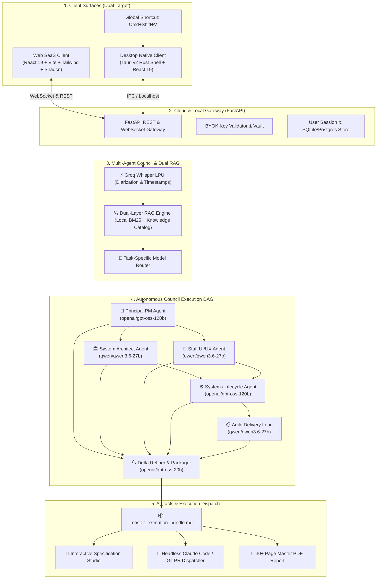

# VoGenFlow 2.0: Master Engineering Implementation Plan
## The Autonomous Voice-to-Architecture Platform & Multi-Agent Council Specification

---

## 1. Executive Summary & Goal Assessment

**VoGenFlow (Voice-based Generative AI for Workflows)** is evolving from an initial local PyQt6 prototype into a **commercial, venture-grade dual-target platform** (Web SaaS + Tauri v2 Native Desktop). It translates unstructured spoken brain-dumps, architectural debates, and whiteboard recordings into production-ready specifications (`PRD.md`, C4 Mermaid `architecture.md`, `flow.md`, `tech_stack.md`, `tasks.md`, `design_proposal.md`, `implementation_plan.md`) and compiles a zero-shot Intermediate Representation (`master_execution_bundle.md`) for autonomous coding agents (Claude Code, Antigravity, Codex).

---

## 2. Decision Ledger: What We STICK WITH vs. What We CHANGE

### ✅ What We STICK WITH (And Technical Rationale)

1. **Groq Whisper LPU (`whisper-large-v3-turbo`)**:
   - *Rationale*: Delivers sub-400ms transcription for 60 seconds of audio. Zero client GPU/VRAM overhead; critical for real-time conversational UX.
2. **In-Memory Okapi BM25 RAG**:
   - *Rationale*: Dense embeddings lose character-level accuracy on code tokens (variable names, route paths, database columns). BM25 provides exact string matching and runs locally with zero external vector database overhead.
3. **Curated Engineering Knowledge Catalog (`data/curated_knowledge.json`)**:
   - *Rationale*: Storing production templates (Shadcn UI component trees, FastAPI async sessions, PostgreSQL DDL schemas) in an in-memory catalog eliminates external DB latency while grounding every prompt in battle-tested patterns.
4. **Task-Specific Multi-Model Routing**:
   - *Rationale*: Distributing roles across specialized models (`openai/gpt-oss-120b` for strategy/PRD, `qwen/qwen3.6-27b` for code/DDL/Mermaid, `openai/gpt-oss-20b` for triage/diffing) eliminates syntax failures and doubles Groq rate-limit throughput.
5. **BYOK (Bring Your Own Key) Commercial Model**:
   - *Rationale*: Delivers 100% gross profit margins, zero cloud inference liabilities for the business, and enterprise compliance (code never passes through shared startup keys).
6. **Air-Gapped Offline Fallback (Local Ollama)**:
   - *Rationale*: Guarantees zero data leakage for enterprise users working on confidential or classified codebases.

---

### ❌ What We CHANGE (And Architectural Rationale)

1. **Retire the Rigid 3-Partition PyQt6 Window**:
   - *Why*: PyQt6 cannot be deployed to the cloud as a SaaS, lacks modern web animation primitives (Tailwind, Framer Motion), and makes interactive diagrams/live component sandboxes difficult to render.
   - *Replacement*: **React 19 + Vite + Tailwind CSS v4 + Shadcn/UI**, bundled for desktop via **Tauri v2 (Rust)** and deployed to cloud via **FastAPI + WebSockets**.
2. **Adopt the "Linear / Raycast" Command Studio Layout**:
   - *Why*: Eliminates cramped static columns in favor of a clean dual-pane workspace: rich specification studio on the left, interactive Mermaid & clickable component canvas on the right, and a floating ambient soundwave voice pill at the bottom.
3. **Multi-Speaker Diarization Integration**:
   - *Why*: Upgrading from single-user voice notes to multi-speaker team debate resolution (distinguishing Engineer A from Tech Lead B and recording the consensus in the PRD).
4. **Token-Efficient Clickable UI Sandbox**:
   - *Why*: Instead of wasting thousands of tokens generating verbose custom HTML/CSS, the UI agent outputs lightweight JSON schemas referencing pre-installed Shadcn UI blocks, mounting live interactive components on the client.
5. **Autonomous PR Dispatcher (Option A + Option B)**:
   - *Why*: Default to exporting a pristine `master_execution_bundle.md` (Option A), with an optional 1-click execution loop (Option B) that spawns a headless Claude Code / Antigravity process to run tests and open a live GitHub Pull Request.

---

## 3. System Architecture & Component Topology

---

## 4. Frontend Design System Specification

### Visual Layout: Linear/Raycast Command Studio
1. **Collapsible Workspace Rail (Left, 240px)**:
   - Active projects, indexed repositories, session history, and live council telemetry.
2. **Dual-Pane Main Canvas**:
   - **Left Pane (55%)**: Specification Studio (Rich markdown rendering, syntax-highlighted code blocks, interactive `- [ ]` task checkboxes).
   - **Right Pane (45%)**: Visual Canvas with toggle between **Interactive Zoomable Mermaid Diagram** (click-to-navigate) and **Clickable Shadcn Component Sandbox**.
3. **Floating Ambient Voice Pill (Bottom Center)**:
   - Backdrop-blurred pill dock (`backdrop-blur-xl bg-zinc-950/80 border border-zinc-800/80`).
   - Real-time Web Audio API waveform canvas with emerald-to-indigo gradient glow.
   - States: *Idle*, *Listening*, *Transcribing (<400ms)*, *Council Synthesizing*.
4. **Global `Cmd + K` Command Palette**:
   - Instant search, repository re-indexing, model switching, and export triggers.

### Linear Dark Theme Tokens

| Token Name | Hex Code | Purpose |
| :--- | :--- | :--- |
| **`bg-canvas`** | `#09090b` | Deep obsidian window background |
| **`bg-card`** | `#18181b` | Component and panel containers |
| **`border-subtle`**| `#27272a` | 1px border separation lines |
| **`accent-emerald`**| `#10b981` | Recording pulse, live status, success indicators |
| **`accent-indigo`** | `#6366f1` | Council agent processing, active tabs, focus rings |
| **`text-primary`** | `#f4f4f5` | High-contrast body typography |
| **`text-muted`** | `#71717a` | Metadata labels and timestamps |

---

## 5. Multi-Model Council Role Specification

| Agent Role | Model Assigned | Deliverable | Key Mandate |
| :--- | :--- | :--- | :--- |
| **1. Principal Technical PM** | `openai/gpt-oss-120b` | `PRD.md` | Executive summary, user journeys, P0/P1/P2 requirements, STRIDE threat models, measurable KPIs. |
| **2. Principal System Architect** | `qwen/qwen3.6-27b` | `architecture.md` | C4 Container diagrams (Mermaid `flowchart TD`), PostgreSQL table DDL with foreign keys, OpenAPI schemas. |
| **3. Staff UI/UX Engineer** | `qwen/qwen3.6-27b` | `design_proposal.md` | Component hierarchy, Tailwind v4 design tokens, Shadcn component mapping, interactive sandbox JSON. |
| **4. Systems Lifecycle Engineer** | `openai/gpt-oss-120b` | `flow.md` | End-to-end Mermaid `sequenceDiagram`, state machines (`stateDiagram-v2`), error recovery matrices. |
| **5. Agile Delivery Lead** | `qwen/qwen3.6-27b` | `tasks.md` & `plan.md` | Granular `- [ ]` task breakdown with explicit file paths, acceptance criteria, and verification commands. |
| **6. Delta Refiner & Packager** | `openai/gpt-oss-20b` | `master_bundle.md` | Cross-document consensus auditing, instant voice delta refinement, zero-shot IR packaging. |
| **Acoustic STT Engine** | `whisper-large-v3-turbo` | Clean Transcript | Sub-second audio transcription with speaker diarization timestamps. |

---

## 6. Implementation Phased Roadmap

### Phase 1: Core Intelligence & Multi-Model Router
- [x] Working speech capture & sub-second Groq Whisper STT.
- [x] In-memory Okapi BM25 RAG engine with query decomposition.
- [ ] Create `data/curated_knowledge.json` (Shadcn UI blocks, FastAPI patterns, PostgreSQL DDL).
- [ ] Implement `src/knowledge_db.py` (In-memory pattern matcher).
- [ ] Implement `src/model_router.py` (Model dispatching across `gpt-oss-120b`, `qwen3.6-27b`, `gpt-oss-20b` with 2-second rate-limit pacing).
- [ ] Implement `src/council_engine.py` (6-agent council orchestration DAG).

### Phase 2: Modern Web SaaS & Tauri Native Client
- [ ] Scaffold `frontend/` (React 19 + Vite + Tailwind CSS v4 + Shadcn/UI + Lucide Icons).
- [ ] Build `AmbientVoicePill.tsx` (Floating bottom dock with Web Audio API visualizer).
- [ ] Build `MermaidLiveViewer.tsx` (Interactive pan/zoom diagram canvas).
- [ ] Build `InteractiveSandbox.tsx` (Clickable Shadcn component preview).
- [ ] Build `CommandPalette.tsx` (Global `Cmd+K` Raycast-style modal).
- [ ] Scaffold `src-tauri/` (Tauri v2 Rust wrapper for native desktop app with `Cmd+Shift+V`).

### Phase 3: Backend Gateway & Execution Loop
- [ ] Implement `src/api/` (FastAPI backend with WebSockets for real-time streaming).
- [ ] Implement `src/master_prompt_compiler.py` (Zero-shot IR packager).
- [ ] Implement `src/pr_dispatcher.py` (Headless Claude Code / Antigravity execution & Git PR creator).

### Phase 4: Verification, Security Audit & Master PDF
- [ ] Expand test suite in `tests/` covering knowledge DB, model router, and council consensus.
- [ ] Recompile 30+ page Master PDF (`output/VoGenFlow_Master_Documentation.pdf`) with embedded UI concept screenshots.
- [ ] Finalize private repository push on branch `main`.
