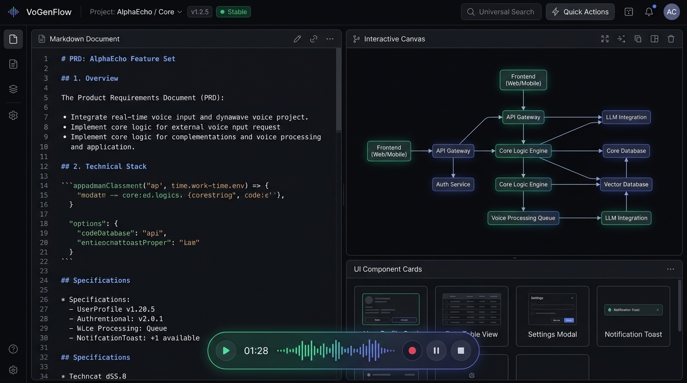

# UI/UX Design System & Aesthetics (design.md)

This document details the visual design tokens, component hierarchy, audio visualization algorithms, and interface architecture for **VoGenFlow 2.0 (Voice-based Generative AI for Workflows)**.

---

## 1. Evolution: Retiring the 3-Partition Layout for the Command Studio

The legacy 3-column desktop layout (Audio Input | Transcript | Blueprints) has been retired in favor of the **Linear/Raycast-Inspired Command Studio**:

```
+---------------------------------------------------------------------------------------------------------+
| [⚡ VoGenFlow]  Legal-AI-Platform / feat-auth  [qwen3.6 + gpt120b]            [Cmd+K]  [🔑 BYOK]  [⚙️]  |
+---------------------------------------------------------------------------------------------------------+
| 📁 WORKSPACE   | 📄 SPECIFICATION STUDIO                 | 🗺️ INTERACTIVE VISUAL CANVAS                |
|                | [PRD.md] [Arch] [Flow] [Tasks] [Plan]   | [Interactive Mermaid / Live UI Sandbox]     |
| • Active Specs |-----------------------------------------|---------------------------------------------|
|   - PRD.md     | # 1. Executive Summary                  | [Zoom +] [Zoom -] [Reset] [Export SVG]      |
|   - Arch.md    | An autonomous legal analytics system... |                                             |
|   - Flow.md    |                                         |  +---------+         +------------------+   |
|   - Tasks.md   | ## 2. Core Value Proposition            |  | FastAPI | ------> | PostgreSQL (DDL) |   |
|                | Reduces case discovery from 5 days to...|  +---------+         +------------------+   |
| • Repositories |                                         |       |                       |          |
|   - Local /src | ## 3. Data Contracts & APIs             |       v                       v          |
|   - Shadcn Ref | - `POST /api/v1/citations/analyze`      |  +---------+         +------------------+   |
|                | - `POST /api/v1/sentiment/extract`      |  | Celery  | <=====> | Redis (Token Bkt)|   |
| • Council Feed |                                         |  +---------+         +------------------+   |
|   - 120B: Done |                                         |                                             |
|   - Qwen: Done |                                         |                                             |
+---------------------------------------------------------------------------------------------------------+
|                           [  🎙️ 00:14.2  ||||||||||||||||||||||||  🛑 Stop  ]                            |
+---------------------------------------------------------------------------------------------------------+
```

---

## 2. Visual Concept & Interface Mockup

Below is the verified UI design concept for VoGenFlow 2.0:


*Figure 1: VoGenFlow 2.0 Linear-Style Command Studio — featuring the dual-pane Specification Studio and Interactive Mermaid/UI Canvas, anchored by the floating ambient soundwave voice pill.*

---

## 3. Core Design Paradigms

### A. The Floating Ambient Voice Pill (Bottom Dock)
* **Dock Geometry**: Centered horizontally, elevated 24px above the bottom viewport edge with backdrop blur (`backdrop-blur-xl bg-zinc-950/80 border border-zinc-800/80 rounded-full shadow-2xl`).
* **Microphone Visualizer**: Driven by the Web Audio API / PortAudio RMS power stream, rendering real-time frequency bars with Gaussian spatial bell-curve distribution and dynamic decay physics.
* **Status Badges**: Shows recording duration, sub-second transcription latency counters (<400ms), and the active Council agent avatar badge.

### B. Dual-Pane Specification & Visual Canvas
* **Specification Studio (Left 55%)**:
  * High-legibility sans-serif typography (Geist / Inter) with syntax-highlighted monospace blocks for code and PostgreSQL DDL.
  * Interactive GitHub-style task checkboxes (`- [ ]`).
* **Visual Canvas (Right 45%)**:
  * **Interactive Mermaid Mode**: Pan, zoom, and click-to-highlight node graphs. Clicking any service node scrolls directly to its section in the PRD.
  * **Clickable Component Sandbox Mode**: Mounts live, interactive Shadcn UI components (Metric Cards, Data Tables, Form Modals) based on the Staff UI/UX agent's JSON specifications without token overhead.

### C. Global `Cmd + K` Command Palette
* Raycast-style instant modal overlay allowing developers to record voice notes, switch models, re-index repositories, and export to GitHub Issues or Claude Code using keyboard shortcuts.

---

## 4. Color Palette & Linear Dark Theme Tokens

| Token Name | Hex Code | Tailwind Utility | Purpose |
| :--- | :--- | :--- | :--- |
| **`bg-canvas`** | `#09090b` | `bg-zinc-950` | Primary obsidian window & page background |
| **`bg-card`** | `#18181b` | `bg-zinc-900` | Card, sidebar, and container surface backgrounds |
| **`border-subtle`**| `#27272a` | `border-zinc-800` | Subtle 1px separation borders |
| **`border-active`**| `#3f3f46` | `border-zinc-700` | Focused input and hovered element borders |
| **`accent-emerald`**| `#10b981`| `text-emerald-500`| Live recording pulse, active microphone, success badges |
| **`accent-indigo`** | `#6366f1`| `text-indigo-500` | Council agent processing, active tab indicator, primary buttons |
| **`text-primary`** | `#f4f4f5` | `text-zinc-100` | High-contrast headers, markdown body text |
| **`text-muted`** | `#71717a` | `text-zinc-500` | Secondary labels, timestamps, token counts |

---

## 5. Audio Visualizer Mathematical Model

The multi-bar waveform visualizer maps real-time RMS audio power into a dynamic frequency spectrum display:

1. **RMS Power Calculation**:
   $$\text{RMS} = \sqrt{\frac{1}{N} \sum_{i=1}^N x[i]^2}, \quad L_{\text{norm}} = \min(1.0, \text{RMS} \times 10.0)$$

2. **Spatial Bell-Curve Weighting**:
   Bars near the center receive higher weight to simulate human vocal resonance:
   $$W(i) = \max\left(0.2, 1.0 - 0.7 \cdot \frac{|i - c|}{c}\right), \quad \text{where } c = \frac{N_{\text{bars}}}{2}$$

3. **Decay Physics**:
   When speech pauses, each bar falls exponentially at rate $\Delta L = -0.05$ every 30ms for natural fluid motion.
