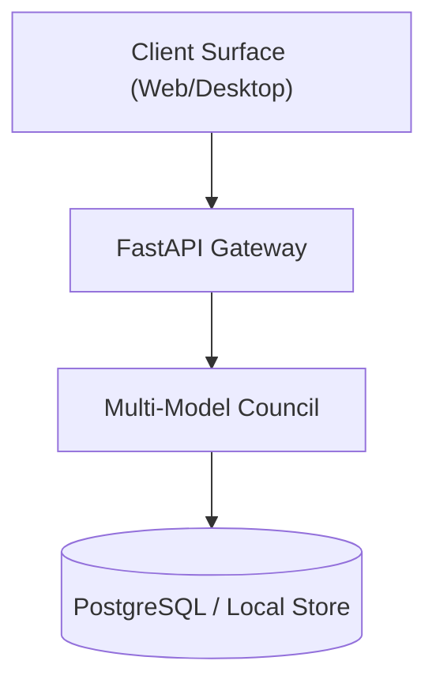

# System Architecture & Database Specification



## Database DDL for Product Requirements Document PRD 1. Executive Summary Autonomous engineering workflow synthesized for Design a high-throughput microservice using...
```sql
CREATE TABLE IF NOT EXISTS projects (
    id UUID PRIMARY KEY DEFAULT gen_random_uuid(),
    title VARCHAR(255) NOT NULL,
    created_at TIMESTAMPTZ DEFAULT NOW()
);
```